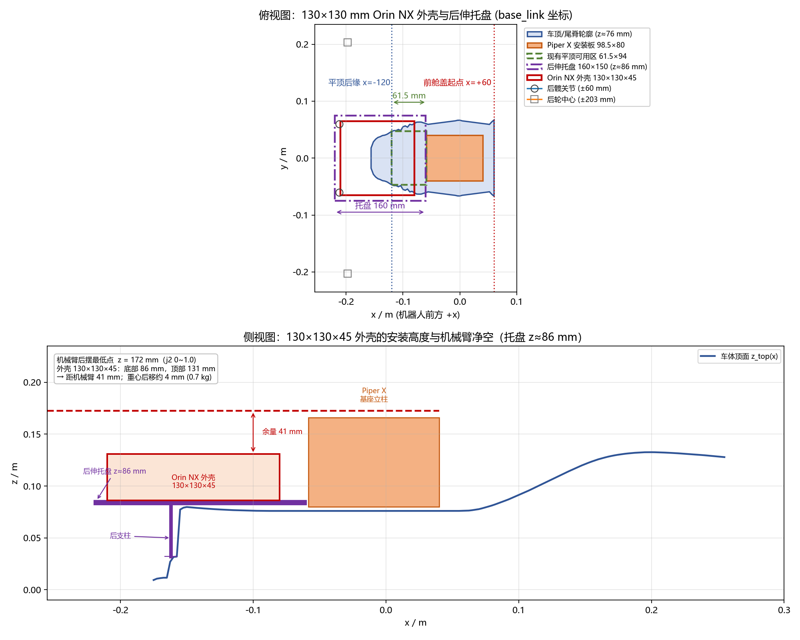

# AS2-W X + Piper X 组合模型（装配说明）

**分支**：`codex/as2w-piperx`（基于 `codex/low-shelf-pick-place`）
**资产**：`deep_robotics_model/AS2W_PiperX/urdf/AS2W_PiperX.urdf`
**生成脚本**：`scripts/tools/build_as2w_piperx_urdf.py`


上行：零位（`q = 0`）；下行：ready 位（`arm_joint2 = 0.5, arm_joint3 = -0.5`）。
四列依次为等轴视图、侧视（+x 向右）、前视、俯视（+x 向右）。灰色 = AS2-W，橙色 = Piper X，青色 = `JT128` 雷达。

## 1. 结论先行

| 项目 | 取值 | 依据 |
|---|---|---|
| 安装位置 | **车身中部（轮距中心）**，`base_to_arm xyz = (0, 0, 0.0798)` | 平甲板 x ∈ [-0.12, +0.06] 的正中间，前伸作业方向留出全部工作空间（见第 3 节） |
| 安装朝向 | **`rpy = (0, 0, 0)`，Piper X 的 +x 指向机器人前方** | 零位时夹爪本来就朝 +x，翻转 180° 后手会朝后（见第 4 节） |
| 底板与甲板间隙 | 3.8 mm | 甲板 z = 0.076，底板底面落在 z = 0.0798（等效垫片层） |
| 总质量 | 27.561 kg（AS2-W 26.000 + Piper X 1.561） | URDF `inertial/mass` 求和 |
| 规模 | 28 links / 27 joints / 54 个 mesh 引用（27 个 STL，约 41 MB） | 生成脚本自检 |

## 2. 资源来源

两个包仓库里都没有，需要另外获取：

| 资源 | 来源 | 落地位置 |
|---|---|---|
| AS2-W X 官方 URDF + 18 个 STL | GitHub `bgzou/log_tmp`，路径 `部署参考/Rob2Nav-as2w-backup/training/as2w-backup/as2w-current/assets/official-model/robots/as2w_description`（`<robot name="AS2W">`，包内没有 `package.xml`，厂商字段未知） | 解压到本地任意目录，脚本用 `--as2w-urdf` / `--as2w-mesh-root` 指定 |
| Piper X 描述包 | 本机 `own_assets/piper_isaac_sim/piper_x_description`（URDF 用 DAE 网格） | `--piperx-urdf` / `--piperx-mesh-root` |

脚本会把 DAE 转成 STL（`trimesh` 三角化），其余 STL 原样复制，因此最终资产是自包含的（只依赖 `urdf/meshes/`）。

## 3. 为什么装在车身中部

对 `base_link` 逐条向下射线（15 mm 栅格，每条射线取第一个命中点）扫出来的顶面：

| 区域 | 范围 | 高度 |
|---|---|---|
| 平甲板 | x ∈ [-0.12, +0.06]，y ∈ [-0.06, +0.06] | 0.076（整片连续） |
| 后倒角 | x < -0.12 | 降到 0.032 |
| 两侧边 | \|y\| > 0.06 | 向外下斜 |
| 前传感器罩 | x > 0.065 | 抬到 0.135（x = 0.335 处最高） |

> 注意：用"每个网格里网格顶点的最高 z"统计会误以为中部有凹槽/开孔——
> 一整块平面往往只在边界有顶点，格子内部没有点。判断可安装面必须用射线扫描。

Piper X 朝 +x 作业，所以基座放在**轮距中点**（髋关节轴线 x = ±0.2119），而不是后甲板：

* 工作空间整体落在车头前方，不会只出现在车尾；
* 1.56 kg 的机械臂压在前/后轴中间，而不是悬在轴距之外；
* 折叠时肘部只伸出车尾 0.11 m（装在后甲板时是 0.21 m）。

`mount_x = 0` 时底板足迹 x ∈ [-0.0585, +0.04]：完整落在平甲板上，前缘距雷达罩起坡点
（x ≈ 0.065）还有约 25 mm，板底距甲板 3.8 mm（等效垫片层）。

## 4. 为什么朝前（Piper X 的前后判断）

零位（所有关节 = 0）下用 FK 算出的关键帧位置（机器人系）：

| 帧 | x | z | 说明 |
|---|---|---|---|
| `arm_base_link` | 0.000 | 0.0798 | 安装法兰 |
| `arm_link1`（肩部转台） | 0.000 | 0.203 | |
| `arm_link3`（肘） | **-0.282** | 0.241 | 肘部向 **-x（后方）** 折 |
| `gripper_base`（末端） | +0.098 | 0.297 | 落在前部雷达罩上方 |
| `gripper_link1`（指尖） | **+0.232** | 0.309 | 手指朝 **+x（前方）** |

也就是说 Piper X 的零位是一个"肘朝后、手朝前"的折叠姿态：

* **保持 `yaw = 0`**：手和机器人传感器同向朝前，正好匹配 `docs/pick_place/low_shelf_place_zh.md`
  里"机器人正面接近货架 -> 降低机身 -> 前俯"的流程；
* **翻转 180°**：手朝后，折叠的肘会甩到前雷达罩上方，取放方向也反了，因此不采用。

需要注意的副作用：零位时肘部会伸出车尾约 0.11 m（-0.282 vs 车尾 -0.175）。
若觉得这个停车姿态太占地方，用 `arm_joint2 = 0.5, arm_joint3 = -0.5`（与
`DEEPROBOTICS_M20_PIPER_CFG` 的初始关节角一致），肘部收到 -0.229（车尾后 0.05 m），
手到 (0.151, 0, 0.427)。

## 5. 命名与关节（与 M20 + Piper 对齐）

AS2-W 侧**保留官方命名**（腿名/关节名是 AS2-W 策略对应关系的一部分，改了会错位）：

```
base_link
  FL_hip/FL_thigh/FL_calf/FL_foot   (FR/RL/RR 同构，*_foot 是 continuous 轮关节)
  JT128                              (fixed，头部雷达)
```

Piper X 侧改成 `M20_Piper_own` 的约定：

| Piper X 原名 | 本资产 |
|---|---|
| `base_link` / `Link1..6` | `arm_base_link` / `arm_link1..6` |
| `Link6` 上的夹爪基座网格 | 拆成独立 `gripper_base`（`joint6_to_gripper_base` 固定连接） |
| `Link7` / `Link8` | `gripper_link1` / `gripper_link2` |
| `joint1..8` | `arm_joint1..6`、`gripper_joint1/2` |

限位/轴向/effort/velocity 全部照抄 Piper X 包：`arm_joint2` 限位 [0, 3.14]、
`arm_joint3` [-2.967, 0]、`gripper_joint1` 0..0.05 m、`gripper_joint2` -0.05..0，
effort 100 / velocity 10（夹爪 1）。

`arm_link6` 没有网格（它的网格是夹爪基座，已挪到 `gripper_base`），这与 M20 + Piper 一致。

## 6. 可达性与间隙（当前 `mount_x = 0`）

机身水平、只动机械臂时：

| 姿态 | `gripper_base` | 臂-机身最小间隙 | 臂自碰最小间隙 |
|---|---|---|---|
| 零位 `q=0` | (0.098, 0, 0.297) | 85.9 mm | 26.5 mm |
| ready `q2=0.5, q3=-0.5` | (0.151, 0, 0.427) | 85.9 mm | 33.7 mm |
| `q2=0.8, q3=-0.8` | (0.211, 0, 0.488) | 85.9 mm | 33.7 mm |
| `q2=1.2, q3=-1.2` | (0.314, 0, 0.535) | 85.9 mm | 33.7 mm |

表中 85.9 mm 是 `arm_link1`（肩部转台）到甲板的固定距离，与手臂姿态无关；
下探时真正先接触的是上臂与前雷达罩，见本节末尾。

4000 组随机关节角（只保留与机身间隙 >= 20 mm 的构型，占 83%）统计出的前伸范围：

| 高度 | `gripper_base` 最大 x |
|---|---|
| z = 0.20..0.30 | +0.620 |
| z = 0.30..0.40 | +0.648 |
| z = 0.40..0.50 | +0.612 |
| z = 0.50..0.60 | +0.527 |

车头在 x = +0.335，也就是说不俯身也能把末端送到车头前约 0.31 m。
更低的取料点靠任务里已有的"降机身 + 前俯"实现；单靠手臂下探时，上臂会在
`q2 ~ 1.2, q3 ~ -0.3` 附近擦到前雷达罩（那是 `docs/pick_place/low_shelf_place_zh.md`
里需要机身前倾的原因之一）。

## 7. 复现

```powershell
python scripts/tools/build_as2w_piperx_urdf.py `
  --as2w-urdf <dir>\as2w_description\as2w.urdf `
  --piperx-urdf <dir>\piper_x_description\urdf\piper_x_description.urdf `
  --mount-x 0 --mount-y 0 --mount-z 0.0798 --mount-yaw 0 --force
```

脚本自检：`base_link` 是唯一根、link/joint 名字唯一、每个 child 只有一个父节点、所有 mesh 文件存在。
额外的数值校核（本次装配时执行）：

* 把 Piper X 原 URDF 的每个 link 网格变换到 `arm_base_link` 系，与本资产对应 link 逐段比较，
  包围盒偏差 < 0.02 mm（`Link3` 的 x+ 端 0.13 mm，来自 DAE→STL 三角化）；
* `gripper_base`（带原 URDF 的 `scale=0.8` 与视觉 origin）偏差 < 0.003 mm；
* 28 个 link 的惯量矩阵均正定、质量均 > 0、所有运动关节都有限位。

## 8. 已知限制 / 后续

1. 仓库里只存 URDF + STL；USD 由 `AS2W_PIPERX_CFG` 在首次加载时自动转换，
   缓存在 `deep_robotics_model/AS2W_PiperX/usd/`（约 60 MB，未入库）。
2. 站立初始角/执行器只针对“静止可视化”整定过（见第 9 节），还没有为行走训练调过。
3. Piper X 原 URDF 的 `Link7` 质量为 0，本资产改成 0.01 kg + 小惯量（Isaac 不接受零质量）。
4. 零位肘部后伸 0.11 m（见第 4 节），仿真里若贴着后墙出生会互相干涉。

## 9. Isaac Sim 静止站立可视化（2026-11-26）

`AS2W_PIPERX_CFG`（`source/rl_training/rl_training/assets/deeprobotics.py`）
+ 专用可视化 task `Visualize-AS2W-PiperX-v0`
（`.../config/wheeled/deeprobotics_as2w_piperx/stand_env_cfg.py`）：

```powershell
conda run -n env_isaac_lab python scripts\tools\zero_agent.py --task Visualize-AS2W-PiperX-v0 --num_envs 1
```

`zero_agent.py` 送全零动作，动作项是 `JointPositionActionCfg(use_default_offset=True)`
⇒ 目标角就是 `AS2W_PIPERX_STAND_JOINT_POS`。环境里没有命令/奖励/随机化，只保留 timeout，
episode 设成 1 h，观察时不会被 reset。

导入方式：`UrdfFileCfg(fix_base=False, merge_fixed_joints=False, self_collision=False,
collider_type="convex_hull", joint_drive=...target_type="none")`，24 个 DOF
（腿 16 + 轮 4 + 臂 6 + 夹爪 2），`JT128` / `base_to_arm` / `joint6_to_gripper_base` 保持 fixed。

### 9.1 站姿

`init_state.pos = (0, 0, 0.45)`：

| 关节 | 目标 | 说明 |
|---|---|---|
| `*_hip` | FL/RL +0.10、FR/RR -0.10 | 轻微外八，轮心 y=±0.203 m |
| `*_thigh` | +0.44 | 膝盖后折 |
| `*_calf` | -0.88 | 小腿回折（URDF 上限 -0.8133，必须比它更弯） |
| `*_foot` | 0 | 轮子纯被动 |
| `arm_joint1/4/5/6` | 0 | |
| `arm_joint2 / 3` | +0.5 / -0.5 | 肘抬起，末端在 base 系约 (0.15, 0, 0.43) |
| `gripper_joint1/2` | 0 | 闭合 |

轮心 x=±0.212 m（正好在髋轴下方）、y=±0.203 m ⇒ 支撑多边形前后、左右都对称，
CoM 落在 x≈+0.01 m，静止裕度充足。`gripper_base` 在车体中心正上方，机械臂朝 +x（车头）。

### 9.2 执行器

| 组 | 关节 | 类型 | Kp | Kd | effort | vel |
|---|---|---|---|---|---|---|
| `hip_thigh` | `.*_hip`、`.*_thigh` | DelayedPD | 250 | 6 | 60 | 25 |
| `calf` | `.*_calf` | DelayedPD | 250 | 6 | 90 | 16.67 |
| `wheel` | `.*_foot` | DelayedPD | 0 | 0.6 | 15 | 98.47 |
| `piper_arm` | `arm_joint[1-6]` | **Implicit** | 300 | 8 | 100 | 3 |
| `piper_gripper` | `gripper_joint[1-2]` | **Implicit** | 286 | 5 | 10 | 1 |

腿/轮用显式 `DelayedPDActuatorCfg`（`min_delay=max_delay=0`，可视化不需要执行器延迟）。
**臂和夹爪必须用 `ImplicitActuatorCfg`**：Piper X 关节惯量只有 1e-4~1e-3 kg·m²，
5 ms 步长下显式 PD 会自激——实测关节在 ±10 rad/s 抖动、力矩顶满 100 N·m
（300/8 且去掉延迟也无效）；换隐式驱动后关节误差 < 1e-3 rad。

### 9.3 实测（1 env，zero action，30 s）

* `base_link` 高 0.4466 m（init 0.45，落 3 mm）；
* `|v| = 6e-4 m/s`、`|ω| = 3e-3 rad/s`；前 5 s 内向前滚 1.1 cm，之后不再移动；
* 关节跟踪误差：髋 < 0.001、大腿 < 0.006、小腿 ≈ 0.02 rad（自重下垂），臂 < 0.005 rad；
* 轮心世界坐标：x=+0.227 / -0.197 m，y=±0.203 m，轮心高 0.077 m。

## 10. 后部 Jetson Orin NX 安装空间核算



结论：**当前安装位置的正后方没有空间直接平放 130×130 mm 的 Orin NX 外壳**；但加一块
160×150 mm 的后伸托盘后可以安装，机械臂净空约 41 mm。裸 Orin NX 模组（69.6×45 mm）
可以跨在尾脊上勉强放下，但“载板 + 外壳”不行。

### 10.1 实测几何（base_link 坐标系）

| 项目 | 数值 |
|---|---|
| 顶面平台高度 | z = 0.076 m |
| 平台后缘（全宽区） | x = -0.120 m |
| Piper X 安装板 | x ∈ [-0.0585, +0.040]，y ∈ [-0.040, +0.040] |
| 安装板后方可用平顶 | **61.5 mm (x) × 94 mm (y)** |
| 尾脊（z≈0.077–0.080） | x ∈ [-0.120, -0.156]，宽度 94 → 44 mm |
| 后横台（z≈0.032） | x ≈ -0.158 ~ -0.162，宽 144 mm |
| 车体最后端 | x = -0.175 m |
| 前舱盖开始抬升 | x = +0.060 m |
| 后髋关节 | x = -0.212 m，y = ±0.060 m（z < 0.043，不占顶面） |
| 后轮中心 | x = -0.197 m，y = ±0.203 m |

机械臂安装板前缘距前舱盖只有 20 mm，**把臂往前挪最多再腾 20 mm**，仍不足以放外壳。

### 10.2 机械臂向后净空

站立位（j2=0.5, j3=-0.5）和零位（j2=0）下，机械臂向后伸到 x≈-0.26 m，但最低点
z≈0.172 m（j2∈[0,1.0] 扫描的最低点）。因此在后部托盘上方
（x∈[-0.21,-0.06]，|y|<0.065）到 z=0.172 m 之前没有臂的干涉，**相对 z=0.086 m
的托盘有约 86 mm 净高**。

注意：j2 接近 π 的“向后翻下”姿态会扫到 z<0 的区域，这是会撞车体的非法姿态，
不应作为停放位；正常向前作业和零位不受影响。

### 10.3 可行方案

1. **后伸托盘（推荐）**：托盘 160×150 mm，z≈0.082–0.086 m，x 从 -0.220 到 -0.060
   （160 mm），y ±0.075（150 mm）。前段用 4 颗螺钉固定在现有平顶上，后段在
   x≈-0.162 用两根约 50 mm 支柱撑在 z≈0.032 m 的后横台上，避免悬臂振动。
   - 外壳 130×130×45 放在 x ∈ [-0.210, -0.080]、y ±0.065：前缘距 Piper X 安装板
     21.5 mm，后缘距托盘边 10 mm，左右各 10 mm。
   - 外壳底部 z=0.086 m、顶部 z=0.131 m；机械臂在后部区域的最低点 z=0.172 m
     （j2∈[0,1.0] 全扫描），**净空 41 mm**。
   - 0.7 kg 外壳使整机重心后移约 3.5–4 mm（整机 27.6 kg），影响可忽略。
   - 线缆可从壳体后缘向后出线（托盘后缘之外是开放空间），或沿托盘侧面走。
2. **不要竖直侧挂**：俯视占位约 45×130 mm 虽然能塞进 61.5 mm 的间隙，但高度会到
   0.18–0.23 m，正好进入机械臂后摆扫掠区，不推荐。
3. **不建议把臂再往前移**：最多 20 mm，收益很小，反而压缩前舱盖处的走线与散热空间。

### 10.4 设计约束

- 托盘顶面高度 ≤ 0.086 m；外壳 45 mm 高时净空 41 mm，≤60 mm 高的外壳仍有 ≥26 mm。
- 托盘后缘不要超过 x=-0.22 m；后轮中心在 -0.197 m、y=±0.203 m，中央仍有余量，
  但悬臂过长会带来振动。
- 外壳 130 mm 宽居中放置；后髋关节在 z<0.043，托盘高于 0.08 m 就不会碰。
- 线缆从托盘前缘沿臂基座侧面走，避免进入机械臂后摆包络（z<0.172 m 区域）。
